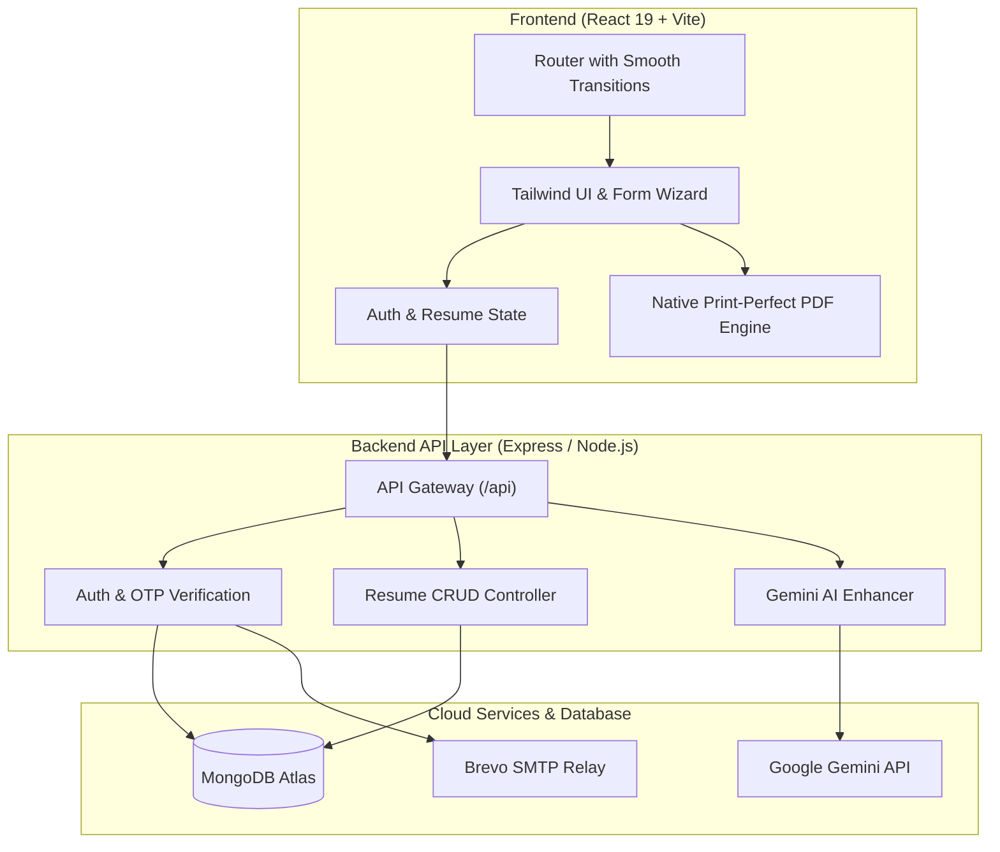

# 📄 AI-Powered Resume Builder

[](https://react.dev/)
[](https://vitejs.dev/)
[](https://tailwindcss.com/)
[](https://nodejs.org/)
[](https://www.mongodb.com/atlas)
[](https://www.brevo.com/)

A full-stack, ATS-friendly **Resume Builder** built to take the pain out of crafting job-ready resumes. It pairs structured resume templates with Google Gemini AI to help you polish bullet points, refine summaries, and export clean, print-perfect PDFs in minutes.

---

## 💡 Why This Project?

Most resume builders either lock basic features behind steep paywalls or export broken PDF layouts that fail Applicant Tracking Systems (ATS). I built this project to solve that:
- **Clean ATS Formatting**: No multi-column weirdness that confuses parsers.
- **AI That Actually Helps**: Turn quick bullet point notes into strong, action-driven XYZ achievements.
- **True Print-Ready PDFs**: CSS print media styling designed for standard US Letter and A4 page dimensions.
- **Real Verification**: Secure 6-digit OTP delivery right to your inbox via Brevo SMTP.

---

## 🏗️ Architecture



---

## ✨ What’s Inside

### 🤖 1. AI Assistant (Powered by Gemini)
- **Bullet Point Polisher**: Transforms raw notes into quantifiable accomplishments using the *"Accomplished [X] as measured by [Y], by doing [Z]"* formula.
- **Summary Generator**: Crafts role-specific professional summaries tailored to your experience level.

### 🎨 2. Recruiter-Approved Templates
- **Classic**: The standard single-column layout preferred by tech and finance recruiters.
- **Modern**: Clean visual accents with clear section separation.
- **Minimal**: High-whitespace typography layout for clean readability.
- **Minimal-Image**: Includes profile image header and categorized skill tags.
- **Live Theme Customizer**: Pick custom accent colors with instantaneous preview rendering.

### 🔐 3. Authentication & Security
- **Email Verification**: Sends live 6-digit OTP codes via Brevo SMTP.
- **Password Strength Guard**: Requires uppercase, lowercase, numbers, and special characters.
- **JWT Sessions**: Secure HTTP-only cookies and Authorization headers.

### 📱 4. Responsive & Smooth UI
- **Instant Scroll-to-Top**: Ensures page switches always start from the top.
- **Fluid Page Transitions**: Subtle `0.36s` ease-in animation between routes.
- **Mobile-Friendly**: Full touch support, swipeable tabs, and mobile drawers for phone screens.

---

## 📂 Project Structure

```text
Resume-Builder-AI-Powered/
├── client/
│   ├── src/
│   │   ├── components/          # Reusable UI cards, forms & templates
│   │   │   ├── templates/       # 4 ATS Resume Templates
│   │   │   ├── ColorPicker.jsx  # Live accent color palette
│   │   │   ├── TemplateSelector.jsx # Template switcher
│   │   │   └── ScrollToTop.jsx  # Instant route scroll manager
│   │   ├── context/             # AuthContext state management
│   │   ├── pages/               # Dashboard, Builder, Login, Blogs, Careers
│   │   ├── services/            # Axios API client
│   │   ├── App.jsx              # Router & page transition wrapper
│   │   └── index.css            # Tailwind theme & animation keyframes
│   └── package.json
├── server/
│   ├── src/
│   │   ├── config/              # MongoDB connection pooling
│   │   ├── controllers/         # Auth, Resume, AI logic
│   │   ├── middleware/          # JWT auth guard & rate limiter
│   │   ├── models/              # User & Resume Mongoose schemas
│   │   ├── routes/              # Express API endpoints
│   │   ├── utils/               # Brevo SMTP mail service
│   │   └── server.js            # Express application setup
│   └── package.json
└── package.json                 # Monorepo root scripts
```

---

## 🛠️ Local Development Setup

### Prerequisites
- [Node.js](https://nodejs.org/) (v18 or newer)
- A [MongoDB Atlas](https://www.mongodb.com/atlas) database URI
- A [Brevo](https://www.brevo.com/) account for SMTP email OTPs
- *(Optional)* A [Google Gemini API Key](https://ai.google.dev/) for AI features

---

### 1. Clone the Repo
```bash
git clone https://github.com/Ujjwal-GoyaL019/Resume-Builder-AI-Powered.git
cd Resume-Builder-AI-Powered
```

### 2. Install Dependencies
```bash
# Install backend dependencies
npm install

# Install frontend dependencies
cd client
npm install
cd ..
```

---

### 3. Setup Environment Variables

#### Backend (`server/.env`):
Create a `.env` file inside the `server/` folder:
```env
PORT=5000
NODE_ENV=development
CLIENT_URL=http://localhost:5173

# Database & Auth
MONGO_URI=mongodb+srv://<user>:<password>@cluster0.xxxxx.mongodb.net/resume-builder?retryWrites=true&w=majority
JWT_SECRET=your_jwt_secret_key_here

# Brevo SMTP (Email OTPs)
SMTP_HOST=smtp-relay.brevo.com
SMTP_PORT=587
SMTP_USER=your_brevo_login_id
SMTP_PASS=xsmtpsib-your_brevo_key
EMAIL_FROM="Resume Builder" <your_email@gmail.com>

# Gemini AI (Optional)
GEMINI_API_KEY=your_gemini_api_key
```

#### Frontend (`client/.env`):
Create a `.env` file inside the `client/` folder:
```env
VITE_API_URL=http://localhost:5000
```

---

### 4. Run Locally

Open two terminals:

**Terminal 1 (Backend):**
```bash
cd server
npm run dev
# Running on http://localhost:5000
```

**Terminal 2 (Frontend):**
```bash
cd client
npm run dev
# Running on http://localhost:5173
```

---

## 📡 API Endpoints Overview

| Method | Route | Description |
| :--- | :--- | :--- |
| `POST` | `/api/auth/register` | Sign up & send 6-digit verification code |
| `POST` | `/api/auth/verify-otp` | Verify OTP code & activate account |
| `POST` | `/api/auth/login` | Log in with email & password |
| `POST` | `/api/auth/resend-otp` | Resend fresh OTP email |
| `POST` | `/api/auth/forgot-password` | Send password reset code |
| `POST` | `/api/auth/reset-password` | Set new password with OTP |
| `GET` | `/api/auth/me` | Get current user profile |
| `GET` | `/api/resumes` | Fetch user's resumes |
| `POST` | `/api/resumes` | Create a new resume draft |
| `GET` | `/api/resumes/:id` | Get resume details |
| `PUT` | `/api/resumes/:id` | Update resume content / template |
| `DELETE` | `/api/resumes/:id` | Delete resume |
| `GET` | `/api/resumes/public/:id` | Public shareable view |

---

## 👨‍💻 Author
Built with ❤️ by **Vishnu**

---

## 📄 License
This project is open-source and licensed under the [MIT License](LICENSE).
